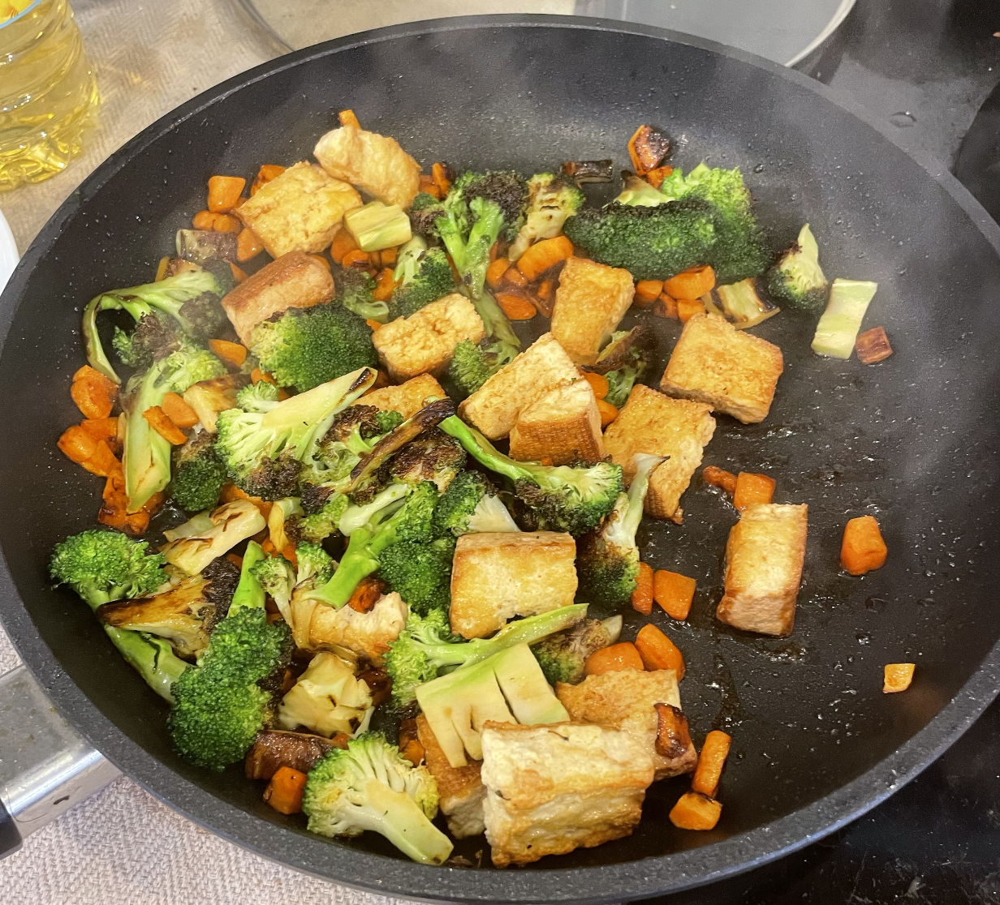
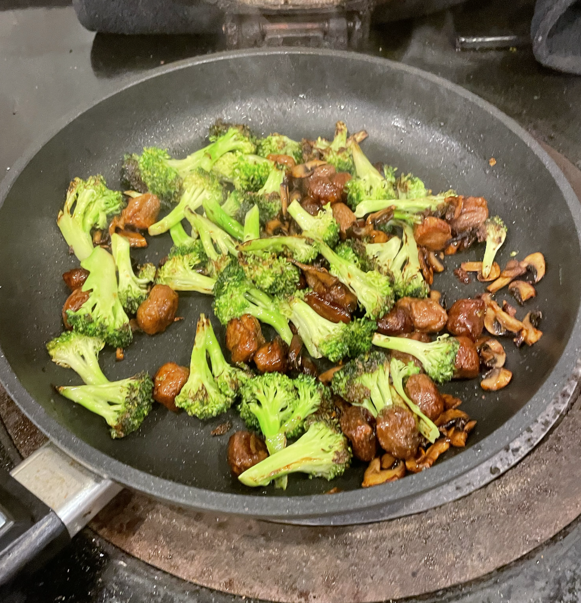
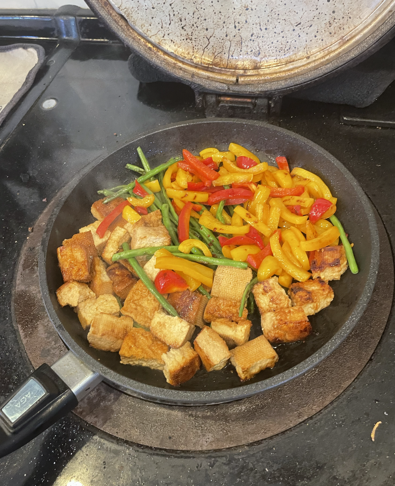

I'm trying to upgrade my stir-frying, which until recently was "fry tofu, add the packet of 'stir fry mix' you got from Tesco and serve.  That definitely needs work. 

I got the book [The Wok: Recipes and Techniques by J. Kenji López-Alt](https://www.goodreads.com/book/show/58085211-the-wok)  (I'd read the sample on Libby, and I was thinking ``I bet this is much easier to read as a proper cookbook because of the pictures and all'' but actually i was wrong - it's got several collums a page and the design doesn't seem to match up well with the content. I think the contact is really good, and the pictures a really good, but the design really doesn't work for me). 

Here are the things I'm learning so far. 

* Limit myself to two or three vegatables, otherwise it's too complicated to get cooking times to work. 
* Why tossing the wok is an actual thing (there is steam in the air directly above the wok, passing things though steam transfers the heat energy back into the food so you are effectively also steaming the food. 
* Better to cook ingredients one at a time than all at once. 
* I use too much oil and should probably start measuring. 

Here are some photos: 

The eagle-eyed reader will note that I'm not using a Wok and given that I'm cooking on an Aga, a Wok wouldn't be any use anyway. At the moment I'm experimenting as much with flavours as anything else; when I move to a burner in the summer I'll treat myself.  

With luck I'll come back to this post in a few months with more knowledge, having read more of the book, but I accept the possibility that this might be all I learn!  There's certainly a bunch of saurces I've never tried.  

